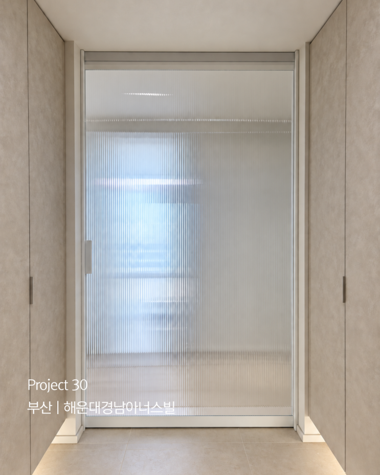

# MMD — 회사 및 상품 소개 웹사이트

인테리어 중문 전문업체 **MMD (MODERN MOOD DESIGN)** 의 회사·상품 소개용 정적 웹사이트입니다.
한 페이지 스크롤형으로, 상단 메뉴를 누르면 해당 섹션으로 이동합니다.

- 참고 자료: MMD 네이버 블로그 <https://blog.naver.com/mmdesign_kr>
- 사용 기술: HTML5 + CSS3 + 순수 JavaScript (빌드 도구·백엔드·DB·로그인 없음)
- 배포: Vercel 등 정적 호스팅에 그대로 올릴 수 있는 구조

---

## 1. 파일 구조

```
프로젝트 루트
├── index.html          ← 홈페이지 본체 (모든 텍스트가 여기에 있습니다)
├── css/
│   └── style.css       ← 디자인·레이아웃·반응형 (미니멀 · 따뜻한 우드톤)
├── js/
│   └── main.js         ← 메뉴, 사진 확대, 시공사례 필터 등 동작
├── images/
│   ├── logo.png        ← 상단 로고 (텍스트 로고와 함께 사용)
│   ├── hero.png        ← 맨 위 큰 대표 사진
│   ├── about.png       ← 회사 소개 옆 사진
│   ├── placeholder.svg ← 사진이 없을 때 쓰는 회색 자리표시 이미지
│   ├── products/       ← 상품 카드 사진 6장
│   │   ├── product-01.png  (원슬라이딩)
│   │   ├── product-02.png  (3연동)
│   │   ├── product-03.png  (양개형 비대칭)
│   │   ├── product-04.png  (양개형 스윙)
│   │   ├── product-05.png  (양개형 외도어)
│   │   └── product-06.png  (프레임·유리 맞춤)
│   └── cases/           ← 시공 사례 갤러리 사진 24장
│       ├── case-01.png
│       ├── case-02.png
│       └── ... case-24.png
└── README.md           ← 이 문서
```

### 이미지 폴더 규칙 (중요)

- `images/` 안에 **종류별로 폴더를 나눠** 두었습니다.
  - `images/products/` → 상품(시공 분야) 카드 사진
  - `images/cases/` → 시공 사례 갤러리 사진
- 파일 이름은 **그대로 두고 내용만 바꾸는 방식**이 가장 안전합니다.
  (예: `images/cases/case-01.png` 파일을 같은 이름의 새 사진으로 덮어쓰기)
- 이름을 바꾸고 싶다면 `index.html` 안의 같은 이름을 함께 바꿔 주세요.
- 사진은 **가로:세로 = 4:5 정도의 세로 사진**을 권장합니다. (권장 크기 1080×1350)
- 용량이 큰 사진(1MB 이상)은 [tinypng.com](https://tinypng.com) 등에서 가볍게 줄이면 페이지가 빨라집니다.

---

## 2. 텍스트 바꾸는 방법

텍스트는 **전부 `index.html` 한 파일 안에** 있습니다. 메모장이나 VS Code로 열어
한글 문장을 찾아 바꿔 주면 됩니다. (`Ctrl+F` 로 검색)

| 바꾸고 싶은 것 | 찾아볼 문장 (예시) |
| --- | --- |
| 브라우저 탭 제목 | `<title>MMD \| 부산·울산·경남 ...` |
| 검색 결과에 나오는 설명 | `name="description" content="MMD(MODERN MOOD DESIGN)는 ...` |
| 상단 메뉴 이름 | `회사소개`, `상품소개`, `시공사례`, `문의` |
| 맨 위 큰 문구(슬로건) | `하루에도 몇 번씩 지나치는 문,` |
| 회사 소개 문단 | `MMD는 'MODERN MOOD DESIGN'이라는 이름처럼 ...` |
| 회사 강점 3가지 | `주문 제작 전문`, `상담부터 시공까지 직접`, `현장 구조와 동선을 먼저` |
| 상품 이름 / 설명 / 특징 | `원슬라이딩 중문`, `3연동 중문`, `양개형 비대칭 중문` ... |
| 시공 사례 이름 | `부산 해운대경남아너스빌` 등 |
| 푸터 저작권 | `© 2026 MMD. All rights reserved.` |

### 시공 사례 사진의 이름과 설명 바꾸기

시공 사례는 사진 한 장마다 아래 세 줄이 한 묶음입니다.
`index.html` 에서 `data-src=` 를 검색하면 찾기 쉽습니다.

```html
<li class="gallery-item" data-type="sliding">
  <button class="gallery-btn" type="button"
          data-src="images/cases/case-01.png"          <!-- ← 사진 파일 -->
          data-title="부산 해운대경남아너스빌"            <!-- ← 확대했을 때 이름 -->
          data-spec="원슬라이딩 · 디아망 시트 + 모루 강화 유리">  <!-- ← 확대했을 때 설명 -->
    
         width="550" height="688" loading="lazy">
    <!-- ↓ 갤러리에서 사진 아래에 보이는 이름표 -->
    <span class="gallery-cap"><strong>부산 해운대경남아너스빌</strong><em>원슬라이딩</em></span>
  </button>
</li>
```

- `data-type` 은 필터 버튼과 연결됩니다.
  `sliding`(원슬라이딩) / `triple`(3연동 도어) / `double`(양개형 도어)
- 사진을 **추가**하려면 `<li> ... </li>` 한 묶음을 통째로 복사해서 붙이고
  위 값들만 새 사진에 맞게 바꿔 주세요. (필터 개수도 자동으로 다시 계산됩니다.)
- 사진을 **줄이려면** 해당 `<li> ... </li>` 묶음을 삭제하면 됩니다.

---

## 3. ⚠️ 꼭 채워야 하는 항목 (`[여기에 입력]`)

블로그에서 확인할 수 없었던 정보는 **임의로 만들지 않고** `[여기에 입력]` 으로 표시해 두었습니다.
아래 위치의 `[여기에 입력]` 을 실제 정보로 바꿔 주세요.

`index.html` 에서 `여기에 입력` 을 검색하면 한 번에 찾을 수 있습니다.

1. **전화번호** (문의 섹션 + 푸터) — 총 2곳
2. **이메일** (문의 섹션 + 푸터) — 총 2곳
3. **주소** (문의 섹션 + 푸터) — 총 2곳
4. **상담 가능 시간** (문의 섹션) — 1곳

### 전화 걸기 버튼도 함께 고쳐 주세요

문의 섹션의 `전화 걸기` 버튼은 `index.html` 에서 아래 부분입니다.
전화번호를 넣으면 휴대폰에서 바로 전화가 걸립니다.

```html
<!-- 바꾸기 전 -->
<a class="btn btn--solid contact-card__btn" id="callBtn" href="tel:">
```

```html
<!-- 바꾼 뒤 (예시) -->
<a class="btn btn--solid contact-card__btn" id="callBtn" href="tel:010-0000-0000">
```

> ※ `href="tel:"` 을 그대로 두면 버튼을 눌렀을 때
> "전화번호를 입력한 뒤 사용할 수 있습니다" 라는 안내창이 뜹니다. (일부러 그렇게 만들어 두었습니다.)

### 배포 주소를 넣은 뒤 손볼 곳 (OG 태그)

카카오톡·문자로 링크를 공유할 때 보이는 미리보기 이미지 주소는 배포 후 절대 주소로 바꾸는 것이 좋습니다.
`index.html` 위쪽의 아래 두 줄을 찾아 `https://실제주소/` 를 넣어 주세요.

```html
<meta property="og:image" content="images/hero.png">   → https://실제주소/images/hero.png
<meta name="twitter:image" content="images/hero.png">  → https://실제주소/images/hero.png
<meta property="og:url" content="https://실제주소/">
```

---

## 4. 블로그에서 확인해 반영한 내용

아래 내용은 모두 MMD 네이버 블로그에서 실제로 확인된 정보입니다. (임의 작성 없음)

- **회사 소개 문구**: "하루에도 몇 번씩 지나치는 문 / 그 짧은 순간이 편안하고 기분 좋기를 바랍니다",
  "현관의 구조와 생활 동선, 집 안의 분위기를 함께 살펴 중문을 제안하고 시공합니다"
- **상호 의미**: MMD = MODERN MOOD DESIGN
- **업종**: 인테리어 중문(현관 중문) 전문 · 주문 제작·시공
- **시공 지역**: 부산 · 울산 · 경남 (창원 · 김해 · 마산 · 양산 · 진해 · 고성 · 장유 · 율하 등)
- **시공 분야(상품)**: 원슬라이딩, 3연동 도어, 양개형 비대칭 도어, 양개형 스윙 도어, 양개형 외도어
- **자재 구성**: 프레임(우드 시트 · 디아망 · 차콜 시트 · 화이트/블랙/골드 도장),
  유리(투명 · 브론즈 · 모루 · 패브릭 · 미스트 · 샤틴 강화유리), 손잡이(기본 · 시트 처리)
- **진행 과정**: 상담 → 현장 실측 → 맞춤 제작 → 시공, 실측 후 최종 견적·일정 안내
- **특징**: 온라인에서 보신 중문 디자인의 약 90%는 MMD 프레임으로 유사 제작 가능
- **시공 사례 24건**: 위 `images/cases/` 사진과 각 현장 이름·사양

---

## 5. 홈페이지 구성

한 페이지 안에 아래 순서로 이어집니다.

1. **헤더** — 로고 + 메뉴(회사소개 / 상품소개 / 시공사례 / 문의). 스크롤해도 상단에 고정
2. **히어로** — 대표 사진 + 슬로건 + `문의하기` 버튼
3. **회사 소개** — 회사 이야기 + 강점 3가지 + 시공 지역
4. **상품 소개** — 카드 6개 (사진 · 설명 · 특징 3개)
5. **시공 사례** — 유형별 필터 + 사진 24장 갤러리 (**클릭하면 크게 보기**)
6. **문의** — 전화 / 이메일 / 주소 + `전화 걸기` 버튼 + 네이버 블로그 링크 (문의 폼 없음)
7. **푸터** — 회사명 · 연락처 · 저작권 문구

### 시공 사례 확대 보기 조작법

- 사진 **클릭** → 확대
- **← / →** 키 또는 **화면 양옆 화살표** → 이전/다음 사진
- **ESC** 키, **닫기(X)** 버튼, **사진 바깥 여백** 클릭 → 닫기
- 모바일에서는 **좌우로 쓸기(스와이프)** 로 사진을 넘길 수 있습니다

### 접근성

- 모든 사진에 대체 텍스트(alt)를 넣었습니다.
- 키보드 Tab 키로 메뉴·버튼·사진을 모두 이용할 수 있습니다.
- `prefers-reduced-motion` 설정을 켠 사용자에게는 애니메이션을 최소화합니다.

---

## 6. 반응형 (휴대폰 · 태블릿 · PC)

모바일 우선으로 만들었습니다. 화면 폭에 따라 자동으로 배치가 바뀝니다.

| 화면 폭 | 내용 |
| --- | --- |
| ~ 639px (휴대폰) | 메뉴가 햄버거 버튼으로 접힘, 카드 1열, 갤러리 2열 |
| 640px ~ | 강점 카드 2열, 문의 카드 2열 |
| 768px ~ (태블릿) | 상품 카드 2열, 갤러리 3열 |
| 1024px ~ (PC) | 메뉴가 가로로 펼쳐짐, 강점 3열, 상품 3열, 갤러리 4열 |
| 1280px ~ | 갤러리 4열 (넓은 화면) |

---

## 7. 로컬에서 확인하는 방법

별도 설치 없이 `index.html` 을 브라우저로 열면 됩니다.
(단, 일부 브라우저는 파일 직접 열기에서 이미지가 안 보일 수 있으므로 아래 방법을 권장합니다.)

```bash
# 프로젝트 폴더에서
python3 -m http.server 8000
# → 브라우저에서 http://localhost:8000 접속
```

또는 VS Code의 **Live Server** 확장을 사용하면 저장할 때마다 자동 새로고침됩니다.

---

## 8. 배포 (Vercel)

빌드 과정이 없으므로 그대로 올리면 됩니다.

1. 이 폴더를 GitHub 저장소에 올립니다. (`index.html` 이 저장소 최상위에 있어야 합니다)
2. [vercel.com](https://vercel.com) → **Add New → Project** → 해당 저장소 선택
3. Framework Preset: **Other**, Build Command / Output Directory 는 **비워 둔 채** Deploy
4. 배포가 끝나면 `https://프로젝트명.vercel.app` 주소가 생성됩니다.
5. 위 **3번 항목의 OG 태그**를 배포 주소로 바꾸고 다시 올리면 링크 미리보기가 정상 동작합니다.

---

## 9. 글꼴

한글 글꼴은 **Pretendard** 를 CDN으로 불러옵니다. (`index.html` 의 `<!-- Pretendard 웹폰트 -->` 부분)
인터넷이 연결되지 않은 환경에서도 기본 한글 글꼴로 자연스럽게 보이도록 대체 글꼴을 지정해 두었습니다.

---

## 10. 남은 작업 (권장)

- [ ] `[여기에 입력]` 항목 채우기 — 전화 · 이메일 · 주소 · 상담 시간
- [ ] `전화 걸기` 버튼의 `href="tel:..."` 에 전화번호 넣기
- [ ] 상품 사진 6장을 회사 보유 사진으로 교체 (현재는 블로그 시공 사진을 사용)
- [ ] 시공 사례 사진 24장을 원본 화질 사진으로 교체
- [ ] 대표 사진(hero)을 MMD가 원하는 메인 사진으로 교체
- [ ] 로고 이미지(`images/logo.png`)를 고해상도 로고로 교체
- [ ] 배포 후 OG 태그의 이미지 주소를 절대 주소로 변경
- [ ] 사업자등록번호·대표자명 등 법정 표기 항목이 필요하면 푸터에 추가

---

© 2026 MMD. All rights reserved.
